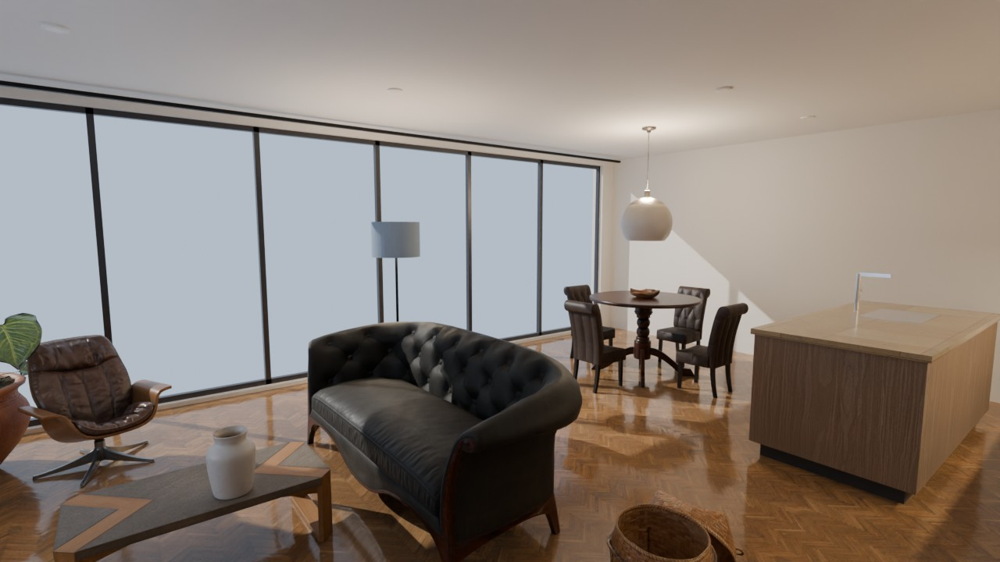

# Habitar

Real estate as a 3D experience, starting with Asunción. Fly over the city, browse listings
by agency or agent, open buildings that exist or not yet, and *live in* a unit before
buying: real sunlight for its orientation, lamps, curtains, the faucet, the TV. Works in
the browser on desktop and phones; WebXR for headsets and an AR portal on Android.

This is **Phase 0**: three technical tests in one app. See [docs/CONCEPT.md](docs/CONCEPT.md)
for the product concept and roadmap.

| Route | What it tests |
|---|---|
| `#/ciudad` | God's-eye map of Asunción: satellite or Google photoreal 3D, 16 demo listings (3 agencies, 6 agents), generated buildings, availability by floor and unit, nearby services from OpenStreetMap with walking rings and routes, real-time sun and night lights |
| `#/hogar` | A unit you can live in: light pre-computed in Blender as layers and mixed live, real sun for Asunción (winter and summer), lamps, curtains, TV, faucet, steam, "moments", walk, magic window, VR, AR portal |
| `#/captura` | Gaussian-splat viewer for captured properties (`.ply`, `.spz`, `.splat`, `.ksplat`, `.rad`) |

All listings, agencies, agents and prices are **fictional demo data**.



## Run it

```bash
npm install
npm run dev          # http://localhost:5173
```

The demo unit (`public/home/demo-unit-villa-morra/`) is committed, so `#/hogar` works
straight away.

### Photorealistic city (optional)

The map works without keys (Esri satellite imagery + OpenStreetMap buildings). For Google
Photorealistic 3D Tiles, create a Google Maps Platform key with the **Map Tiles API**
enabled, restrict it to your domains, and either paste it in the app (map → *Activar
fotorrealista*, stored in that browser only) or put it in `.env.local`:

```
VITE_GOOGLE_MAPS_API_KEY=AIza...
```

Google bills Map Tiles per session (check current pricing) and requires its attribution,
which the app shows.

## Pipelines

### Units: Blender, headless

`pipeline/blender/build_unit.py` builds a unit from a JSON spec with Blender as a Python
module, places CC0 furniture from Poly Haven, unwraps lightmap UVs (one atlas for the
architecture, one for furniture), bakes every light layer with Cycles, denoises them
(edge-aware à-trous filter guided by position and normal passes), and exports a glb, the
lightmaps (RGBE in PNG) and a manifest.

```bash
python -m venv .venv && .venv/bin/pip install bpy==5.3.0 numpy   # Python 3.13
PYTHON=.venv/bin/python pipeline/build_unit.sh pipeline/blender/specs/demo-unit-villa-morra.json
# add --preview for path-traced reference renders of every view
```

About 20–30 minutes on 4 CPU cores. Then `scripts/optimize-glb.mjs` compresses the glb
(WebP textures, meshopt geometry): 36 MB → about 5 MB.

### Captures: Gaussian splats

`pipeline/splat/process_capture.sh` turns a phone walkthrough or drone orbit into a splat
(ffmpeg → COLMAP/GLOMAP → gsplat). It needs a CUDA GPU and hasn't been run in the build
environment yet. See [docs/CAPTURE.md](docs/CAPTURE.md) for how to film.

## Layout

```
src/
  main.ts, hub.ts            router + landing
  city/                      map: tiles, camera flights, listings, Tower (procedural
                             buildings), PoiLayer (services, rings, routes), osm.ts (Overpass)
  home/                      unit: HomeView, LightLayers (GPU lightmap mixer),
                             WalkControls (+ magic window), life.ts (steam, water, TV,
                             sound), xr.ts (VR + AR portal)
  splat/                     Spark-based splat viewer
  shared/                    i18n (es-PY / en), solar position, tweening, DOM helpers
pipeline/
  blender/                   build_unit.py + unit specs
  splat/                     process_capture.sh
public/
  data/asuncion/             demo listings
  home/<unit>/               built units (glb, lightmaps, manifest)
scripts/                     Poly Haven fetch, glb optimisation
```

## Stack

three.js r187 (WebGL 2, WebXR), [3d-tiles-renderer](https://github.com/NASA-AMMOS/3DTilesRendererJS)
for the globe, [Spark](https://sparkjs.dev) for Gaussian splats, Vite + TypeScript, Blender 5.3
(`bpy`) for baking, glTF-Transform for compression.

## Credits

Imagery © Esri, Maxar, Earthstar Geographics. Map data © OpenStreetMap contributors (ODbL).
Google Photorealistic 3D Tiles © Google (with a key). Furniture, textures and panorama:
[Poly Haven](https://polyhaven.com) (CC0). Concept inspired by God's Eye View by Bilawal Sidhu (MIT).
