# RCM Holdings — Kit de Identidad de Marca

El sistema completo de identidad visual de **RCM Holdings**, desarrollado a partir de la lámina original
*Visual Identity System* (`source/reference/rcm-visual-identity-sheet.jpg`) y ampliado a un manual de marca
completo con archivos listos para producción. *English version: [README.md](README.md).*

<p align="center">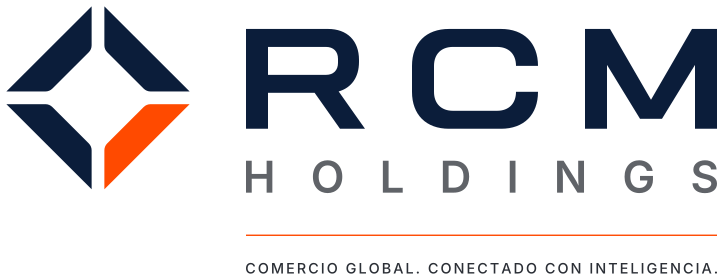</p>

| | |
|---|---|
| **Manual de marca (PDF)** | [`RCM-Holdings-Manual-de-Marca.pdf`](RCM-Holdings-Manual-de-Marca.pdf): 28 páginas, A4 horizontal |
| **Manual de marca (HTML)** | [`manual/index.es.html`](manual/index.es.html): ábralo en un navegador e imprima a PDF con los gráficos de fondo activados |
| **Vista previa de páginas** | [`manual/previews-es/`](manual/previews-es) |
| **Edición en inglés** | [`RCM-Holdings-Brand-Manual.pdf`](RCM-Holdings-Brand-Manual.pdf) · [`manual/index.html`](manual/index.html) |

<p align="center">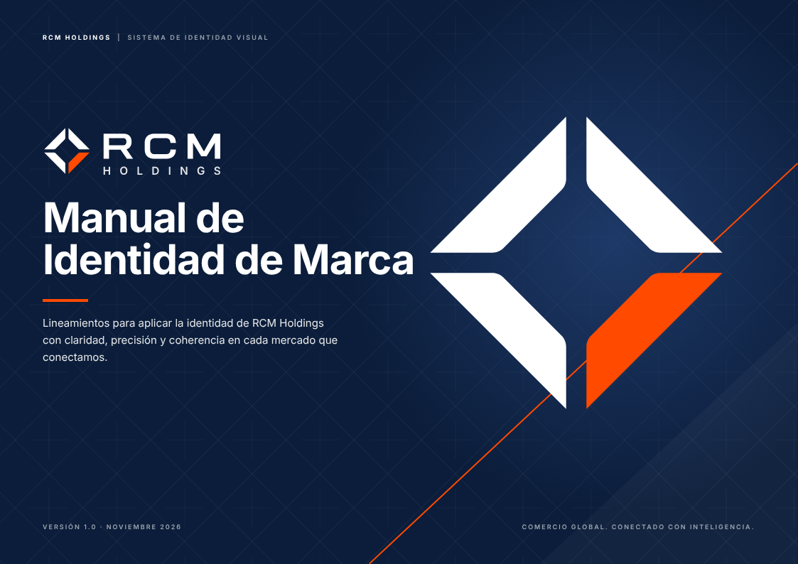 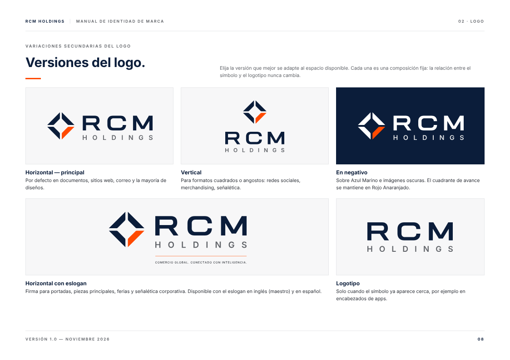<br>
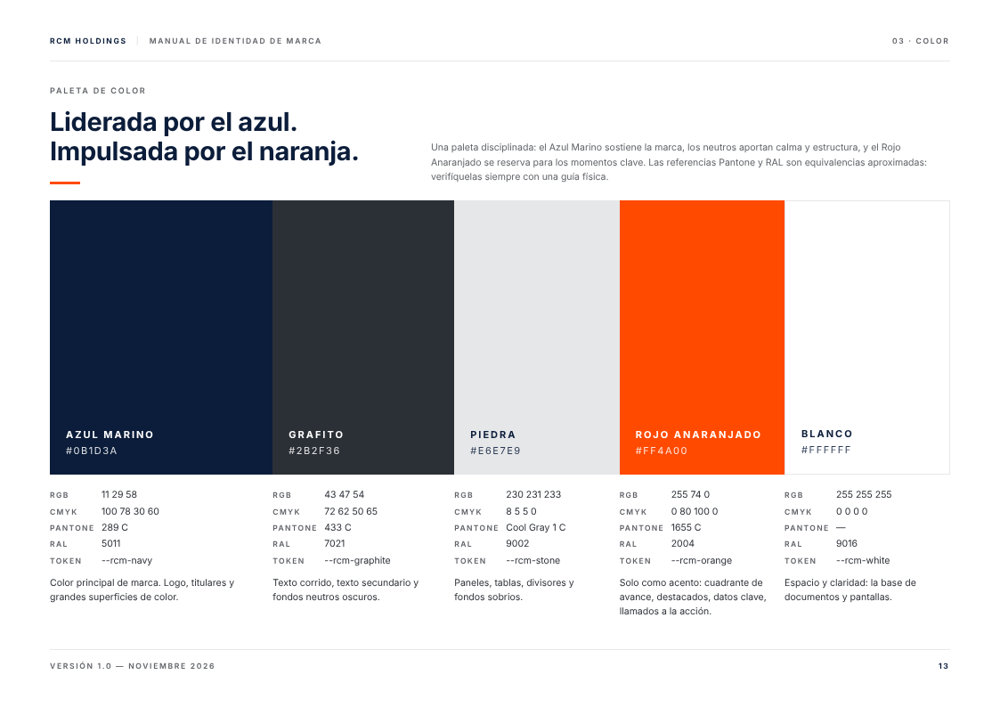 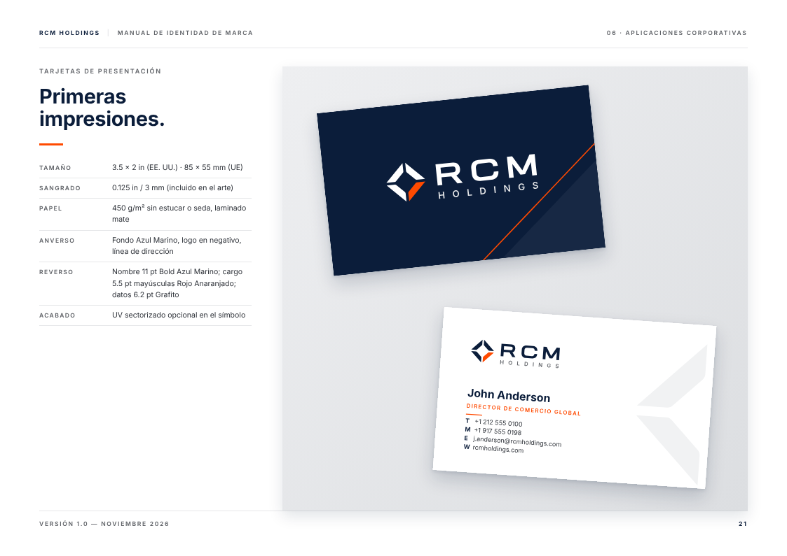</p>

## Contenido del kit

Los archivos en español llevan el sufijo **`-es`**. Los nombres de carpetas y archivos se mantienen en inglés
para que el kit funcione igual en ambos idiomas.

```
rcm-holdings/
├── RCM-Holdings-Manual-de-Marca.pdf   manual en español
├── RCM-Holdings-Brand-Manual.pdf      manual en inglés
├── logos/
│   ├── horizontal/            logo principal
│   ├── horizontal-tagline/    firma con eslogan: inglés (maestro) y -es ("Comercio global. Conectado con inteligencia.")
│   ├── stacked/               versión vertical (símbolo sobre el logotipo)
│   ├── wordmark/              solo RCM + HOLDINGS
│   ├── symbol/                el símbolo
│   │      cada uno en: fullcolor (a todo color) · reverse (negativo) · navy · white · black (a una tinta)
│   ├── app-icon/              ícono de app (redondeado, a sangre, claro), favicon.svg, favicon.ico
│   └── png/                   exportaciones PNG transparentes en varios anchos
├── color/                     CSS · SCSS · tokens JSON · preset de Tailwind · .ase (Adobe) · .gpl (GIMP/Inkscape/Affinity)
│                              rcm-palette-es.svg / .png: lámina de paleta en español
├── graphics/                  ilustraciones (-es con textos en español), tramas de rombos, exploraciones del símbolo
├── icons/                     12 íconos: svg/ · svg-reverse/ · svg-mono/ · rcm-icon-sheet-es.svg
├── templates/                 cada plantilla en inglés y en español (-es)
│   ├── print/                 tarjeta (anverso/reverso, con sangrado) · hoja membretada Carta + A4 · sobre #10 · carpeta
│   ├── digital/               portada de LinkedIn · publicación social · firma de correo HTML
│   ├── presentation/          portada · separador de sección · diapositiva de contenido (1920 × 1080)
│   ├── documents/             factura comercial (HTML + PDF)
│   ├── signage/               elevación del muro de recepción con cotas
│   └── png/                   vistas previas de cada plantilla
├── manual/                    index.html (EN) · index.es.html (ES) · manual.css · img/ · previews/ · previews-es/
└── source/                    generadores: cada recurso se reconstruye desde una geometría maestra
```

## Logo

| Horizontal (principal) | Vertical | Símbolo | Ícono de app |
|---|---|---|---|
| 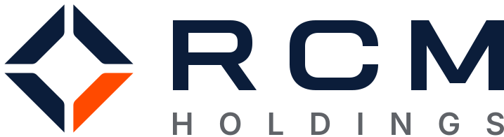 | 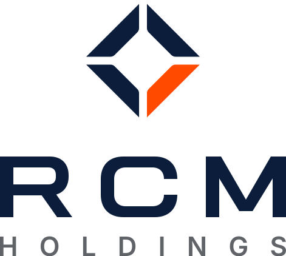 | 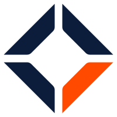 | 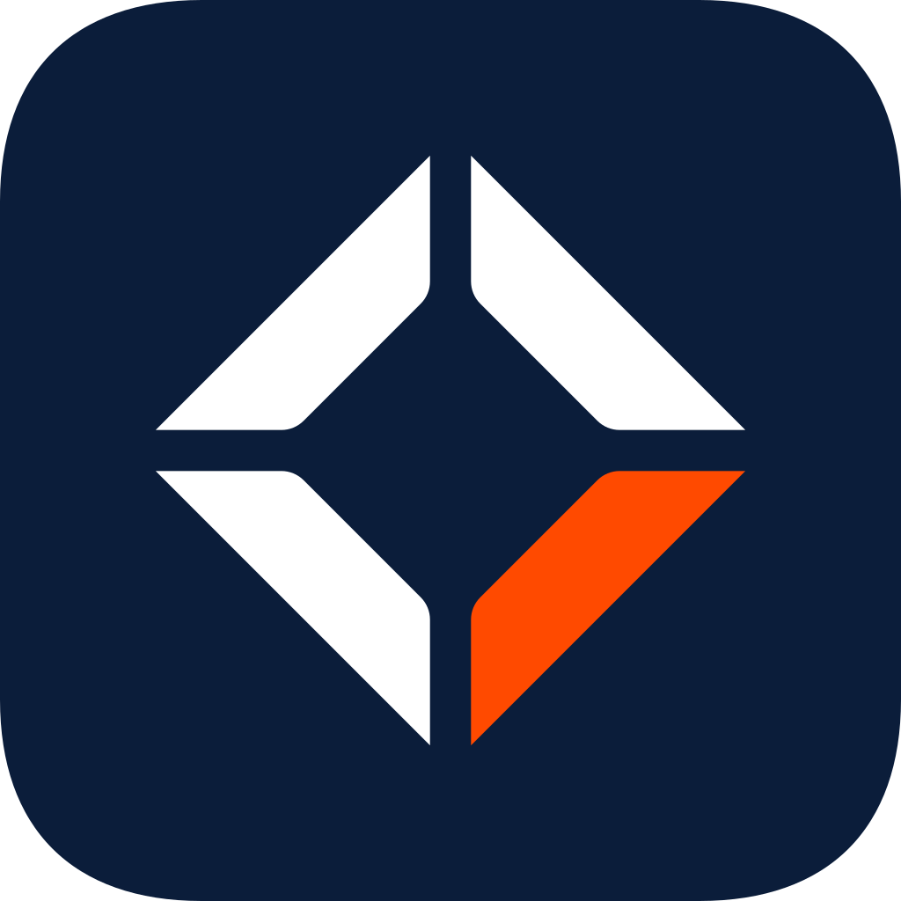 |

* **Zona de protección:** X en todos los lados, donde X = altura de las mayúsculas del logotipo RCM.
* **Tamaño mínimo:** horizontal 30 mm / 120 px · con eslogan 50 mm / 200 px · vertical 18 mm / 72 px · símbolo 6 mm / 16 px (use `rcm-favicon.svg` por debajo de 24 px).
* Todos los logos son arte vectorial trazado: no requieren fuentes instaladas.
* El nombre "RCM Holdings" y el descriptor "HOLDINGS" no se traducen.

## Color

| | Nombre | HEX | RGB | CMYK | Pantone* | RAL* | Proporción |
|---|---|---|---|---|---|---|---|
|  | Azul Marino (Navy Blue) | `#0B1D3A` | 11 29 58 | 100 78 30 60 | 289 C | 5011 | 60% |
| 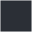 | Grafito (Graphite) | `#2B2F36` | 43 47 54 | 72 62 50 65 | 433 C | 7021 | 20% |
| 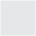 | Piedra (Stone) | `#E6E7E9` | 230 231 233 | 8 5 5 0 | Cool Gray 1 C | 9002 | 10% |
|  | Rojo Anaranjado (Orange Red) | `#FF4A00` | 255 74 0 | 0 80 100 0 | 1655 C | 2004 | 10% |
|  | Blanco (White) | `#FFFFFF` | 255 255 255 | 0 0 0 0 | n/a | 9016 | base |

\* Los valores Pantone, RAL y CMYK son equivalencias aproximadas como punto de partida. Verifíquelos siempre con muestras físicas antes de producir.

Los tokens de código (`--rcm-navy`, `--rcm-orange`, etc.) conservan los nombres en inglés en ambas ediciones.

## Tipografía

* **Principal: Aktiv Grotesk** (Dalton Maag, requiere licencia comercial). Regular, Medium, Bold.
* **Secundaria: Inter** (libre, SIL Open Font License). Digital, interfaces, presentaciones; sustituta aprobada de Aktiv Grotesk.
* **Alternativa de sistema: Arial** para correo y configuraciones de oficina por defecto.

> El manual en PDF está compuesto en Inter, porque Aktiv Grotesk no se puede distribuir libremente.

## Reconstruir el kit

```bash
pip install fonttools skia-pathops        # requiere la familia tipográfica Inter instalada
./brand/rcm-holdings/source/build_all.sh  # requiere Node.js + Playwright (Chromium) e ImageMagick
```

Los textos en español de las plantillas están en `source/build_templates.py` (diccionario `TXT["es"]`);
los de las ilustraciones e íconos, en `source/build_assets.py`.

## Notas

* El símbolo y el logotipo **RCM** se reconstruyeron como geometría vectorial precisa a partir de la lámina de referencia.
  El descriptor **HOLDINGS** y el eslogan se trazaron desde Inter SemiBold/Medium. Si existe el arte maestro original,
  compárelo con estos archivos antes de reemplazarlo.
* **El eslogan en español** ("Comercio global. Conectado con inteligencia.") es una adaptación propuesta: apruébela
  antes de usarla en piezas definitivas. El eslogan en inglés sigue siendo el maestro.
* Nombres, teléfonos, direcciones y datos de factura en las plantillas son **ejemplos** (números 555, empresas ficticias).
* La firma de correo requiere el PNG del logo alojado en una dirección pública `https://` (ver comentarios en el HTML).
