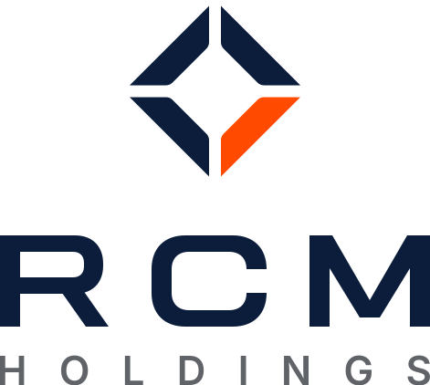
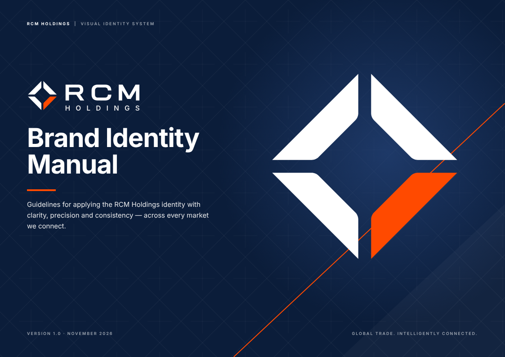
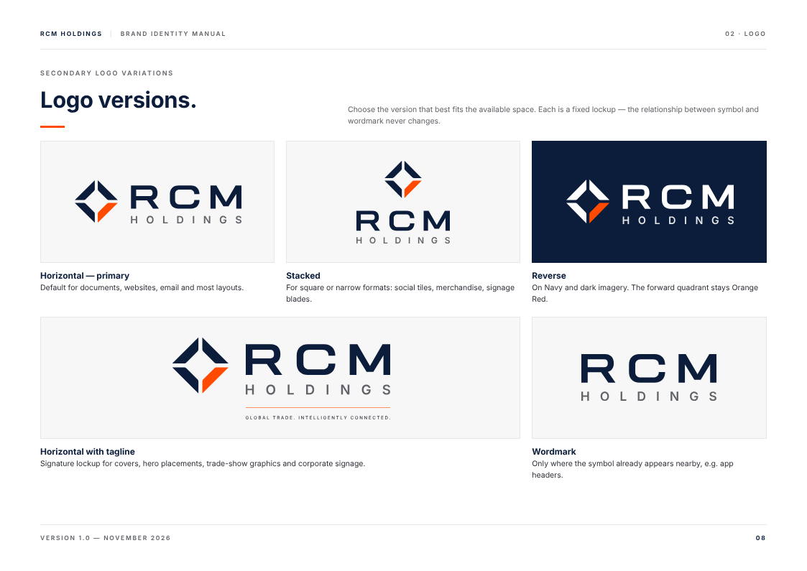
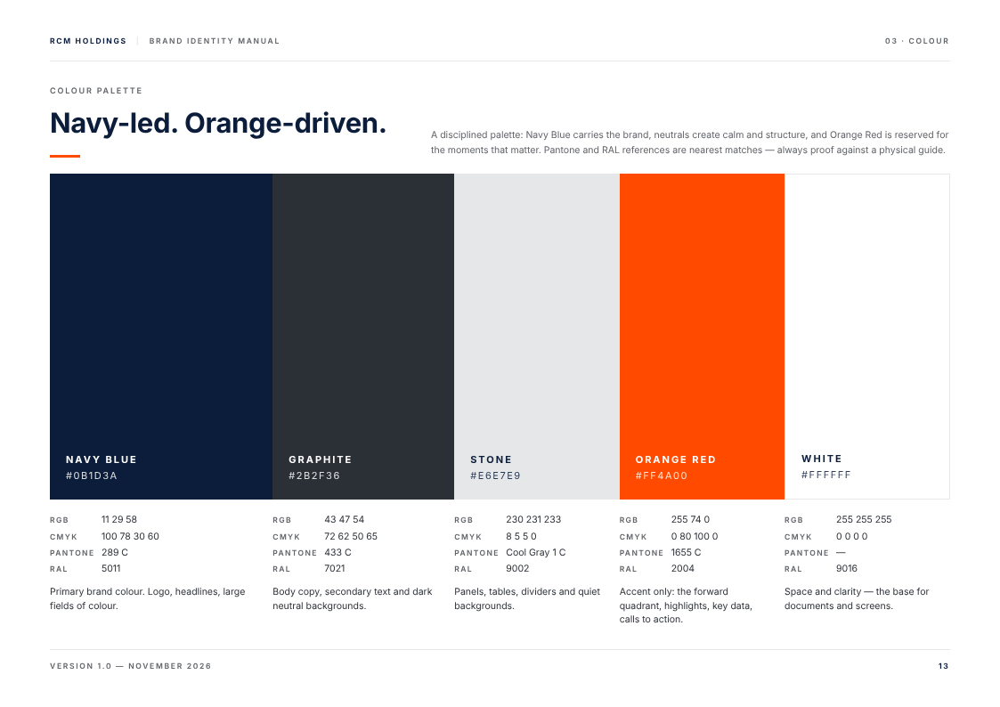
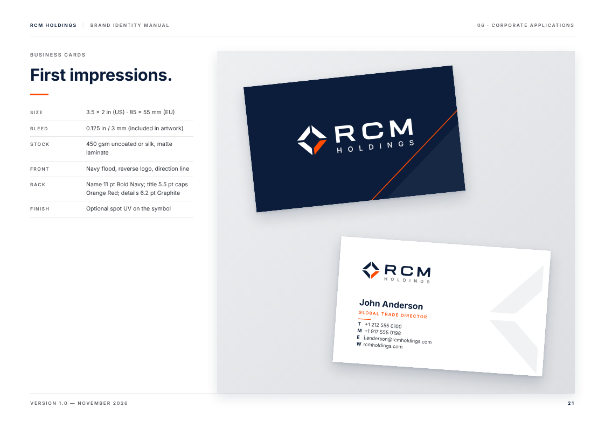
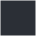
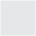

# RCM Holdings — Brand Identity Kit

The complete visual identity system for **RCM Holdings**, built from the original *Visual Identity System* sheet
(`source/reference/rcm-visual-identity-sheet.jpg`) and expanded into a full brand manual with production-ready files.

<p align="center"></p>

| | |
|---|---|
| **Brand manual (PDF)** | [`RCM-Holdings-Brand-Manual.pdf`](RCM-Holdings-Brand-Manual.pdf): 28 pages, A4 landscape |
| **Brand manual (HTML)** | [`manual/index.html`](manual/index.html): open in a browser; print to PDF with background graphics on |
| **Page previews** | [`manual/previews/`](manual/previews) |
| **Spanish edition / Edición en español** | [`RCM-Holdings-Manual-de-Marca.pdf`](RCM-Holdings-Manual-de-Marca.pdf) · [`manual/index.es.html`](manual/index.es.html) · [`README.es.md`](README.es.md) |

## What's inside

```
rcm-holdings/
├── RCM-Holdings-Brand-Manual.pdf
├── RCM-Holdings-Manual-de-Marca.pdf   Spanish edition
├── logos/
│   ├── horizontal/            primary logo
│   ├── horizontal-tagline/    signature lockup with "Global trade. Intelligently connected."
│   │                          (-es: "Comercio global. Conectado con inteligencia.")
│   ├── stacked/               symbol above wordmark
│   ├── wordmark/              RCM + HOLDINGS only
│   ├── symbol/                the diamond symbol
│   │      each in: fullcolor · reverse · navy · white · black
│   ├── app-icon/              app icon (rounded, full-bleed, light), favicon.svg, favicon.ico
│   └── png/                   transparent PNG exports (multiple widths)
├── color/                     CSS · SCSS · JSON design tokens · Tailwind preset · .ase (Adobe) · .gpl (GIMP/Inkscape/Affinity)
├── graphics/                  visual-language illustrations, diamond-lattice patterns, symbol explorations (+ png/)
├── icons/                     12 service icons: svg/ · svg-reverse/ · svg-mono/ · contact sheet
├── templates/                 every template in English and Spanish (files suffixed -es)
│   ├── print/                 business card front/back (with bleed) · letterhead US Letter + A4 · #10 envelope · folder
│   ├── digital/               LinkedIn banner · social post · HTML email signature
│   ├── presentation/          cover · section divider · content slide (1920 × 1080)
│   ├── documents/             commercial invoice (HTML + PDF)
│   ├── signage/               reception wall elevation with dimensions
│   └── png/                   previews of every template
├── manual/                    index.html · manual.css · img/ (diagrams) · previews/
└── source/                    generators: every asset is rebuilt from one master geometry
```

## Logo

| Horizontal (primary) | Stacked | Symbol | App icon |
|---|---|---|---|
|  |  |  |  |

Reverse versions (`*-reverse.svg`, white + Orange Red) are for Navy and dark backgrounds; see page 11 of the manual.

<p align="center"> <br>
 </p>

* **Clear space:** X on every side, where X = cap height of the RCM wordmark.
* **Minimum size:** horizontal 30 mm / 120 px · with tagline 50 mm / 200 px · stacked 18 mm / 72 px · symbol 6 mm / 16 px (use `rcm-favicon.svg` below 24 px).
* All logo files are fully outlined vector artwork: no fonts required.

## Colour

| | Name | HEX | RGB | CMYK | Pantone* | RAL* | Share |
|---|---|---|---|---|---|---|---|
|  | Navy Blue | `#0B1D3A` | 11 29 58 | 100 78 30 60 | 289 C | 5011 | 60% |
|  | Graphite | `#2B2F36` | 43 47 54 | 72 62 50 65 | 433 C | 7021 | 20% |
|  | Stone | `#E6E7E9` | 230 231 233 | 8 5 5 0 | Cool Gray 1 C | 9002 | 10% |
|  | Orange Red | `#FF4A00` | 255 74 0 | 0 80 100 0 | 1655 C | 2004 | 10% |
|  | White | `#FFFFFF` | 255 255 255 | 0 0 0 0 | n/a | 9016 | base |

\* Pantone, RAL and CMYK values are nearest matches for a starting point. Always proof against physical swatches before production.

Web projects: `@import "color/rcm-colors.css";` or add `presets: [require('./color/tailwind.rcm.cjs')]` to `tailwind.config`.

## Typography

* **Primary: Aktiv Grotesk** (Dalton Maag, commercial licence required). Regular, Medium, Bold.
* **Secondary: Inter** (free, SIL Open Font License). Digital, UI, presentations, and the approved substitute for Aktiv Grotesk.
* **System fallback: Arial** for email and default office settings.

> The PDF manual is set in Inter, because Aktiv Grotesk is not freely distributable. Install licensed Aktiv Grotesk and re-export to see the primary typeface.

## Rebuilding the kit

All artwork is generated from the master geometry in `source/rcm_brand.py` (symbol proportions, custom RCM letterforms, lockup spacing and colours).

```bash
pip install fonttools skia-pathops        # Inter font family must be installed
./brand/rcm-holdings/source/build_all.sh  # needs Node.js + Playwright (Chromium) and ImageMagick
```

## Notes

* The symbol and the custom **RCM** wordmark were reconstructed as precise vector geometry from the reference sheet.
  The **HOLDINGS** descriptor and tagline are outlined from Inter SemiBold/Medium. If the original master artwork
  exists, have the design owner compare it against these files before they replace it.
* Names, phone numbers, addresses and invoice data in templates are **placeholders** (555 numbers, sample companies).
* The email signature needs the logo PNG hosted at a public `https://` URL (see comments in the HTML file).
